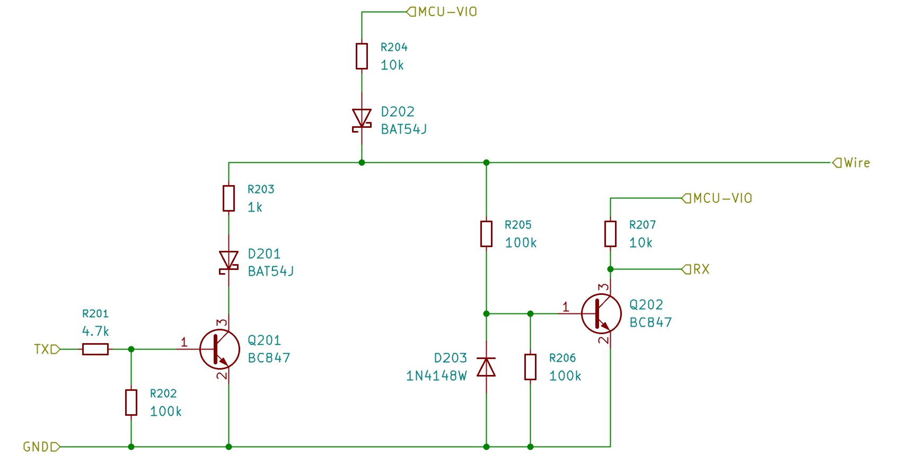

# GUIwire

**GUIwire** is a bidirectional, patchable data interface for modular synthesizers and other embedded systems.

Its primary purpose is to let a functional module expose a graphical user interface without requiring that module to contain its own display.

Instead, a separate display or control module can be connected through an ordinary patch cable. The connected device provides its identity, user-interface description, state, and optional interaction model over GUIwire. The display module renders that interface and may return user interaction events.

In a Eurorack environment, GUIwire uses a standard **3.5 mm TS patch cable**:

```text
TIP     DATA
SLEEVE  GND
```

Only one data conductor is required.

```text
┌─────────────────┐
│ Display / Host  │
│                 │
│         GUIwire ○──────────────○ GUIwire
└─────────────────┘              │
                                 │
                          ┌──────┴───────┐
                          │ Functional   │
                          │ Module       │
                          └──────────────┘
```

Changing the patch connection changes the device represented by the display.

---

## Motivation

Many digital and hybrid synthesizer modules need some form of visual feedback, but often only occasionally.

Giving every module its own display increases:

- front-panel space
- component cost
- power consumption
- firmware complexity
- hardware complexity
- long-term maintenance requirements

It also duplicates functionality. A system containing several modules may contain several displays even though the user typically interacts with only one of them at a time.

GUIwire separates the **function of a module** from the **hardware used to visualize and control it**.

The functional module knows what information it wants to present.

The display module knows how to render that information.

GUIwire connects the two.

---

## Conceptual Architecture

GUIwire is divided into several layers.

```text
┌────────────────────────────────┐
│ GUI / Application Protocol     │
│                                │
│ UI model, state, events,       │
│ device capabilities            │
├────────────────────────────────┤
│ GUIwire Link Layer             │
│                                │
│ framing, synchronization,      │
│ integrity, sessions            │
├────────────────────────────────┤
│ GUIwire Physical Layer         │
│                                │
│ single-wire half duplex,       │
│ electrical protection          │
└────────────────────────────────┘
```

This separation is intentional.

The graphical protocol is kept separate from display hardware and MCU
peripherals. GUIwire defines the physical connection, link framing and the
structured GUI application packets that travel over it.

The current standard profile is intentionally self-contained: an
implementation must not assume a second transport, a shared clock or a
display-specific peripheral bus.

---

## Design Goals

GUIwire is intended to be:

- electrically simple
- inexpensive to implement
- compatible with ordinary Eurorack patch cables
- bidirectional
- hot-pluggable
- tolerant of typical Eurorack mispatch conditions
- usable with both 3.3 V and 5 V microcontrollers
- independent of a particular MCU family
- independent of a particular display
- independent of screen resolution
- packet-oriented and recoverable after communication errors
- suitable for both display output and user input
- implementable without a specialized bus-transceiver IC

The reference implementation deliberately uses common discrete components.

---

## Non-Goals

GUIwire is not initially intended to become a general-purpose Eurorack control network.

The primary topology is:

```text
one host/display
       ↕
one functional device
```

The physical signaling mechanism could potentially support more complicated topologies, but multidrop operation, arbitration, and general networking are outside the initial specification.

GUIwire is also not intended to carry:

```text
audio
CV
gate
clock
trigger
power
```

It is a digital communication interface.

---

## Physical Connection

The reference Eurorack implementation uses a standard mono 3.5 mm connector:

```text
TIP     GUIwire DATA
SLEEVE  GND
```

No supply voltage is transmitted through the cable.

Every participant powers its own GUIwire transceiver.

This is important because connected devices may operate with different local supply and logic voltages.

---

## Single-Wire Half-Duplex Communication

GUIwire uses one shared data conductor.

Communication is **half duplex**: either side may transmit, but only one participant transmits at a given time.

```text
Host                         Device

──── request ──────────────────>

<────────────────── response ───
```

The line uses an open-collector style signaling scheme.

```text
HIGH = idle / recessive
LOW  = active / dominant
```

Participants do not actively drive the external line HIGH. The line returns HIGH through pull-up circuitry.

This makes the electrical interface naturally suitable for a shared bidirectional conductor.

---

## Separate TX and RX Inside the Module

The external interface contains only one DATA conductor, but the reference transceiver presents separate TX and RX signals to the microcontroller.

```text
            MCU
         ┌───────┐
   TX ───┤       │
   RX ───┤       │
         └───────┘
            │
            │
      GUIwire transceiver
            │
            │
          DATA
```

This simplifies firmware considerably.

The MCU does not need to electrically switch a GPIO between input and output modes for every transaction. The transceiver combines both directions onto the external line.

This also allows implementations to use conventional UART peripherals, programmable I/O engines, or software-defined serial interfaces.

---

## Reference Transceiver

The current reference design uses two NPN transistors:

```text
Q1   transmit stage
Q2   receive stage
```

Conceptually:

```text
                     MCU-VIO
                        │
                    pull-up
                        │
                        ▼
TX ── TX stage ───── GUIwire
                        │
                        ▼
                  RX protection
                        │
                        ▼
                       RX
```

The present reference implementation uses components such as:

```text
Q1/Q2    BC847

D1       BAT54J
D2       1N4148W
D3       BAT54J
```



together with resistors for current limiting, biasing, and pull-ups.

The exact component values and schematic belong to the hardware specification rather than the high-level protocol definition.

---

## MCU-VIO

GUIwire deliberately does not define one mandatory internal MCU logic voltage.

Each transceiver has a local voltage called:

```text
MCU-VIO
```

This is normally the logic supply of the attached microcontroller.

Typical values are:

```text
3.3 V
5 V
```

For example:

```text
RP2040       3.3 V
RP2350       3.3 V
STM32        3.3 V
ESP32        3.3 V
SAMD         3.3 V

ATmega328P   5 V
ATmega32U4   5 V
```

The RX side of the transceiver is pulled up to the **local MCU-VIO**.

The MCU therefore sees only its own logic voltage, independently of the voltage present on the external GUIwire line.

---

## Mixing 3.3 V and 5 V Devices

A major design goal is direct interoperability between 3.3 V and 5 V systems.

For example:

```text
RP2040                       ATmega328P

MCU-VIO = 3.3 V              MCU-VIO = 5 V

      GUIwire ○──────────────○ GUIwire
```

Both devices use the same transceiver topology.

The external idle voltage does not need to equal the local MCU logic voltage.

Schottky isolation in the pull-up path prevents a higher external line voltage from feeding back into a lower-voltage MCU supply.

The receive transistor then converts the line state back into a clean local logic level.

No conventional bidirectional logic-level converter is required.

---

## Eurorack Mispatch Protection

An exposed Eurorack jack must be assumed to encounter signals that were never intended to be digital communication signals.

Possible accidental connections include:

```text
positive CV
negative CV
audio
gate
trigger
+12 V
-12 V
```

For this reason, GUIwire does not connect the jack directly to a microcontroller pin.

The reference transceiver uses:

- series resistance
- transistor isolation
- Schottky isolation
- negative-voltage clamping
- local logic-level regeneration

The design objective is that typical Eurorack voltage excursions do not directly reach an MCU GPIO or back-feed the local logic supply.

Typical fault scenarios considered by the reference design include approximately ±12 V being applied to DATA.

This should be regarded as a **design requirement to be validated by simulation and hardware testing**, rather than merely assumed from the schematic.

---

## Hot-Plugging

GUIwire is designed for patching while the system is running.

A connection may therefore:

- appear at any time
- disappear at any time
- disappear in the middle of a frame
- reconnect to a different device
- begin while either participant is already running
- begin with arbitrary residual data in receive buffers

The protocol must never assume that both participants were powered on together or began communication in a synchronized state.

A receiver must always be capable of recovering synchronization.

### Hot-patch session lifecycle

The cable is passive and provides no separate presence signal. When it is
unplugged, DATA simply returns to its idle state. Presence is therefore
detected at the link layer by the absence of valid responses.

While a session is active, the Host sends `POLL` regularly. The recommended
poll interval is at most 100 ms. After three consecutive response timeouts,
or after its configured session timeout without a valid response, the Host declares the session lost
and immediately:

- stops sending interaction data
- discards partial receive data
- clears all Device-owned objects from its scene
- shows a neutral disconnected/no-device state
- starts discovery again with `PING`

The previous Device treats the absence of authenticated Host frames for its
configured session timeout as a disconnect. It then stops transmitting, discards its pending
GUI queue and marks the session inactive. Its functional state remains intact;
it must not assume that the Host is still displaying it.

The Host sends a fresh eight-byte session token in every `PING`. The Device
echoes it and binds all subsequent requests and responses to that token.
If a running Device receives a `POLL` or rate request carrying a different
token, it replies `SESSION_MISMATCH`; the Host clears its old scene and begins
a new `PING` handshake. This detects a client swap without waiting for an
unplug timeout, even if the new Device was already active. At a different
baud rate, the Host first returns to 9600 baud through the silent fallback.
Any rate observations used to optimize a connection belong to that session:
after a confirmed disconnect or client change, the Host discards them and
starts the new client at 9600 baud. A transient packet error is not itself
evidence of a different client. Without a separate presence signal, cable
removal cannot be recognized at the exact instant it happens; the Host uses
bounded response timeouts and the base-rate handshake to identify the peer.

Once the new Device has answered `PING`, its first queued GUI packet must be
`DESTROY_ALL_OBJECTS`, followed by `HELLO_STRING`, the complete current
interface and the current state. The Host ignores Device object packets until
that initial destroy command has been received, then polls until `SESSION_EMPTY`.
Each object response carries a sequence number. The Host acknowledges it in
the next `POLL`; until then the Device keeps it available for retransmission.
The Host applies a duplicate sequence only once.
This prevents objects from the previous Device from appearing in the new
display.

The complete handover is therefore:

```text
Host                     previous Device          new Device
 │                              │                      │
 │── POLL(token A) ────────────►│                      │
 │                              │  cable moved         │
 │── POLL(token A) ───────────────────────────────────►│
 │◄──────────────────────── SESSION_MISMATCH ─────────│
 │── clear old scene            │── expire session    │
 │── PING(token B) ───────────────────────────────────►│
 │◄──────────────────────── PING(token B) ────────────│
 │── POLL(token B, ACK) ──────────────────────────────►│
 │◄──── SESSION_DATA(DESTROY_ALL/HELLO/objects) ──────│
 │── render new complete scene                         │
```

If a frame is interrupted during the handover, the receiver discards it and
restarts at the next `SYNC`. No manual reset or power cycle is required.

---

## Host and Device Roles

GUIwire uses the terms **Host** and **Device**.

### Host

The Host provides the user-interface hardware.

It may contain:

```text
display
encoder
buttons
touch interface
other controls
```

It interprets the interface description received from the connected Device and presents it to the user.

### Device

The Device is the functional module.

Examples could include a:

```text
tuner
LFO
sequencer
spectrum analyzer
MIDI interface
power monitor
oscillator
filter controller
```

The Device owns its functional state and communicates the relevant parts of that state to the Host.

The Host normally initiates communication.

---

## Connection Establishment

A newly connected Host initially knows nothing about the Device.

A connection therefore conceptually proceeds through several stages:

```text
Host                           Device

        physical connection

──── discovery ─────────────────>

<──────── identification ────────

──── session setup ─────────────>

<──── interface description ─────

<──── state updates ──────────────

──── interaction events ─────────>
```

The exact messages are defined by the protocol specification, but the conceptual rule is important:

> A Device should not assume that a particular Host or display implementation is connected.

Likewise, the Host should not require prior knowledge of every possible Device.

The Host grants each Device response opportunity with `POLL`. In a reliable
session the Device returns one `SESSION_DATA` envelope containing a queued
object command, or `SESSION_EMPTY`. The envelope binds the response to the
current client and lets the Host acknowledge its sequence in the next poll.
This keeps the single shared conductor deterministic.

---

## Device Identification

A GUIwire Device may expose basic metadata describing itself and its protocol capabilities.

Conceptually this can include information such as:

```text
protocol version
device class
manufacturer
product identifier
firmware version
capabilities
supported interface features
```

This allows future Hosts and Devices to negotiate compatible behavior without requiring every combination to have been designed together.

---

## GUI Model

GUIwire does not transmit complete rendered framebuffers.

In the current v1 profile, the Device communicates a compact representation
made from GUI objects. It describes object geometry, colours, text and state;
the Host decides how those objects are rasterized on its particular display.

This object profile is intentionally practical for small microcontrollers. A
future semantic-widget profile may describe values and controls at a higher
level, but it must be negotiated separately and must not change the v1 object
packets.

For a future semantic extension, a tuning device could expose conceptual
values such as:

```text
note
octave
target frequency
measured frequency
deviation
```

while another device may expose:

```text
frequency
waveform
mode
level
state
```

The Host is responsible for translating the received objects into a concrete
visual representation.

This allows the same Device to potentially work with very different Hosts:

```text
128 × 64 monochrome OLED
larger graphical OLED
colour TFT
touch display
desktop debugging application
web-based development interface
```

The core distinction is:

```text
Device:  what should be represented?

Host:    how should it be represented?
```

---

## State-Oriented Communication

After the initial interface has been established, GUIwire should avoid retransmitting the complete interface continuously.

Instead, communication is primarily based on state changes.

Conceptually:

```text
Initial state:

Note       C#
Frequency  138.59 Hz
Deviation  +0.1 cent
```

If only the deviation changes, only that state needs to be updated.

This reduces:

- bandwidth
- processing requirements
- unnecessary redraws
- protocol overhead

The Host retains the current interface state until it is replaced, updated, or the session ends.

---

## Bidirectional Interaction

GUIwire is not restricted to passive displays.

A Host may contain interactive controls.

The Device can expose an interface containing interactive elements, and the Host can report user actions back to the Device.

Conceptually:

```text
Device                       Host

──── interface element ───────>

                         user acts

<──── interaction event ───────
```

This makes GUIwire suitable not only for remote displays, but also for future shared control surfaces.

The functional behavior always remains under control of the Device.

---

## Link Layer

The standard transport is an asynchronous byte stream over the single DATA
conductor. The mandatory startup electrical format is **9600 baud, 8 data bits,
no parity, one stop bit (8N1)**. Higher rates are negotiated after discovery.
The transceiver may invert the signal internally;
the bytes visible to the protocol are not inverted.

A link frame is:

```text
┌──────┬────────────┬──────────────────┬─────────┐
│ SYNC │ frame_len  │ application      │ CRC-16  │
│ 0x7E │ u16 LE     │ packet           │ u16 LE  │
└──────┴────────────┴──────────────────┴─────────┘
```

`frame_len` is the number of unescaped bytes in the application packet,
including its six-byte application header. Valid application packets are
`6..256` bytes long. CRC-16/CCITT-FALSE is initialized to `0xFFFF` and is
calculated over the unescaped `frame_len` field followed by the complete
application packet. The CRC is transmitted least-significant byte first.

Byte stuffing is applied to `frame_len`, the application packet and the CRC:

```text
0x7E  →  0x7D 0x5E
0x7D  →  0x7D 0x5D
```

Any other escape sequence is invalid. A new `SYNC` abandons the current
candidate frame. The receiver validates length, application header and CRC
before executing a command.

The application packet retains the compact object protocol:

```text
┌────────┬────────┬─────────┬────────┬────────────┬─────────┐
│ magic0 │ magic1 │ version │ command│ payload_len│ payload │
│  'G'   │  '2'   │   u8    │  u8    │    u16 LE  │   ...   │
└────────┴────────┴─────────┴────────┴────────────┴─────────┘
```

`magic1 = '2'` is retained for application-packet compatibility with the
predecessor profile; it does not describe the GUIwire electrical layer.
`version` is `0x01`; `payload_len` must equal the remaining packet length.
The command registry and all object payload layouts are defined in
[`docs/protocol.md`](docs/protocol.md).

The v1 command identifiers are:

| Command | Value | Direction |
|---|---:|---|
| `PING` | `0x01` | Host ↔ Device |
| `HELLO_STRING` | `0x02` | Device → Host |
| `POLL` | `0x03` | Host → Device |
| `NO_DATA` | `0x04` | Device → Host |
| `GET_LINK_INFO` | `0x05` | Host → Device |
| `LINK_INFO` | `0x06` | Device → Host |
| `SET_BAUD` | `0x07` | Host → Device |
| `BAUD_ACK` | `0x08` | Device → Host |
| `SESSION_DATA` | `0x09` | Device → Host |
| `SESSION_EMPTY` | `0x0A` | Device → Host |
| `SESSION_MISMATCH` | `0x0B` | Device → Host |
| `DESTROY_ALL_OBJECTS` | `0x10` | Device → Host |
| `CREATE_*` / `UPDATE_*` | `0x11..0x1D` | Device → Host |

`POLL` grants the Device one response opportunity. In a reliable session it
returns one session-tagged queued application packet or `SESSION_EMPTY`; this keeps the single data conductor
collision-free while allowing the Device to publish its interface and state
changes.

---

## Synchronization and Recovery

Synchronization is especially important because GUIwire is intentionally hot-pluggable.

Communication may begin with:

```text
garbage bytes
a partial previous packet
an interrupted transmission
noise caused by insertion
a recently reset participant
```

A valid GUIwire receiver must therefore be able to discard invalid data and
eventually recover at the next recognizable frame boundary. A receiver resets
its frame parser on a new `SYNC`, an invalid length, an invalid escape or a
CRC failure. No command is executed before all validation has succeeded.

No manual reset should be required after normal repatching.

---

## Data Integrity

The standard link frame uses **CRC-16/CCITT-FALSE** for packet integrity.

The initial value is `0xFFFF`; the CRC is calculated over the unescaped
`frame_len` field and complete application packet, then transmitted
least-significant byte first.

The objective is not to provide cryptographic protection.

The objective is simply to make the receiver able to distinguish reliably between:

```text
a valid frame
```

and

```text
a damaged or incomplete frame
```

Invalid packets are discarded.

A corrupted frame must never be interpreted as a partially valid GUI operation.

---

## Data Rate and Negotiation

All compliant implementations must support the safe startup rate:

```text
9600 baud, 8N1
```

The Host and Device may advertise additional rates after the first successful
`PING`. The demonstrator offers 19200, 38400 and 57600 baud; 115200 baud may
be advertised only when the complete electrical path has been verified for
it. A participant must never switch rates merely because it transmitted a
request: `BAUD_ACK` is sent at the old rate and the switch happens only after
that frame has completed.

The negotiation sequence is:

```text
Host                                      Device

PING ─────────────────────────────────────►
      ◄──────────────────────────────────── PING
GET_LINK_INFO ────────────────────────────►
      ◄──────────────────────────────────── LINK_INFO
SET_BAUD(rate, token) ────────────────────►  (old rate)
      ◄──────────────────────────────────── BAUD_ACK(rate, token)
both participants switch to rate           Device switches after ACK
```

Within a reliable session, `GET_LINK_INFO` carries the eight-byte session
token; `LINK_INFO` echoes it before `u8 count` and the little-endian `u32`
baud rates. `SET_BAUD` contains the session token, `u32 rate` and `u8`
rate-transition token; `BAUD_ACK` repeats them. A Device that does not
implement `GET_LINK_INFO` causes the Host to continue at the startup rate.

The reference Host first builds the GUI at 9600 baud, then tests *one* common
higher rate at a time, in ascending order. Normal `POLL` exchanges continue
between negotiation frames; three consecutive valid responses at the new rate
confirm each step. This is testing during operation, **not** simultaneous use
of two baud rates on the wire. Each participant changes its UART only at the
acknowledged turn boundary. The Host counts valid and erroneous replies per
rate within the current session. It normally waits at least 5 seconds before
another step and requires 60 seconds of clean operation at the lower rate
before probing 57600 baud. After a recovery it may re-ascend through previously
confirmed lower rates sooner, but each step is still acknowledged and tested.

The Device keeps a watchdog while operating above 9600 baud. If it receives
no valid Host frame for the negotiated fallback interval, it silently returns
to 9600 baud, without discarding its queued GUI state. The reference interval
is 400 ms; its 2500 ms Device-session timeout is longer than the Host's quiet
recovery window. After a lost acknowledgement or two unanswered high-rate
requests, the Host waits for that fallback interval plus a margin, switches
itself to 9600 baud and verifies communication with `POLL`. The existing GUI
remains visible during this trial and recovery; only a failed base-rate
verification ends the session and starts fresh discovery. A rate that failed
or was stepped down is retried after successively longer pauses of 1, 2, 4
and up to 8 minutes within that session. One corrupt or missing `POLL` reply
does not trigger a rate change; repeated errors with successful exchanges in
between may cause a confirmed one-step downshift using the same
`SET_BAUD`/`BAUD_ACK` handshake. When the ACK or both high-rate replies are
missing, the peers cannot safely assume the same rate and use the 9600-baud
fallback instead. Independent implementations must coordinate their fallback
and session timeouts accordingly.

The physical interface should be designed with significantly higher rates in
mind.

Higher-bandwidth applications may include:

```text
spectrum displays
waveform data
meters
rapidly changing visualizations
```

The initial hardware should therefore avoid unnecessary limitations that would make future operation at several hundred kilobaud impractical.

Actual supported rates must be established through hardware measurements rather than assumed solely from MCU capability.

---

## Half-Duplex Turnaround

Because GUIwire is half duplex, ownership of the line changes between
participants.

A typical exchange looks like:

```text
HOST TX
████████████

            turnaround

DEVICE TX
             ████████████
```

The transmitting side must release the line after its stop bit. The other side
waits at least two character times before transmitting. The Host schedules all
exchanges; the Device transmits only during the response opportunity granted
by a Host request.

`PING` receives a token-echoing `PING` response. `POLL` receives exactly one
`SESSION_DATA` packet or `SESSION_EMPTY`. The Host must not begin another frame until the Device
has released the line or a response timeout has elapsed. The timeout must
cover the accepted maximum frame size after worst-case byte stuffing. For a
256-byte packet at 9600 baud, serialization alone can take about 543 ms;
the reference Host adds a turnaround/processing margin and scales the timeout
with the current rate.

These rules prevent both sides from intentionally transmitting at the same
time and make reconnection deterministic.

---

## Receive-Signal Inversion

The reference transistor receiver currently inverts the external wire state.

Conceptually:

```text
GUIwire HIGH  → MCU RX LOW
GUIwire LOW   → MCU RX HIGH
```

This is an implementation detail of the reference transceiver, not a property of the higher-level GUI protocol.

The inversion may be handled by:

```text
UART hardware
programmable I/O
peripheral configuration
software decoding
```

A different electrically compatible transceiver would not necessarily need to expose an inverted RX signal internally.

---

## Microcontroller Independence

GUIwire requires only modest MCU resources.

A typical implementation needs:

```text
one transmit signal
one receive signal
a timer/UART/PIO/software serial implementation
```

The protocol is therefore not tied to Raspberry Pi silicon.

Potential implementations include:

```text
RP2040
RP2350
ATmega
AVR
STM32
SAMD
ESP32
PIC
```

The reference repository should contain implementations on substantially different architectures to ensure that accidental assumptions about one MCU do not become part of the specification.

---

## Reference Demonstrator

The initial GUIwire demonstrator intentionally connects a 5 V microcontroller to a 3.3 V microcontroller.

This directly exercises one of the main properties of the physical layer.

### Device side

A classic Arduino Nano / ATmega328P can represent the 5 V side:

```text
MCU-VIO = 5 V

D1 / TX  → GUIwire TX
D0 / RX  ← GUIwire RX
```

### Host side

A Raspberry Pi Pico / RP2040 can represent the 3.3 V side:

```text
MCU-VIO = 3.3 V

GP0  → GUIwire TX
GP1  ← GUIwire RX
```

The Pico can additionally drive a small local display. Its display controller
and local display bus are outside the GUIwire connection; no particular local
display interface is required by this standard.

The complete demonstrator therefore represents:

```text
5 V MCU
   │
GUIwire
   │
3.3 V MCU
   │
display
```

This setup demonstrates both communication and mixed-voltage interoperability.

---

## Application protocol inheritance

The initial GUIwire application profile retains the established compact object
protocol. The essential concept is:

```text
functional device
describes interface
       │
       ▼
display host
renders interface
```

GUIwire separates this GUI model from the electrical transport:

```text
             GUIwire
                │
        ┌───────┴────────┐
        │                │
   application       link/physical
    objects             framing
```

The object identifiers, payload layouts, little-endian encoding, RGB565
colours and rendering semantics are therefore part of GUIwire v1. New
transport features must not silently change those application packets.

---

## Why Not Direct UART?

The simplest possible circuit would be:

```text
MCU GPIO ───────── patch jack
```

GUIwire deliberately avoids this.

A direct connection would create several problems:

```text
3.3 V / 5 V incompatibility
negative Eurorack voltages
+12 V mispatches
backfeeding through GPIO protection diodes
insufficient isolation
hot-plugging stress
```

The discrete transceiver is therefore considered part of the GUIwire physical-layer concept rather than an optional accessory.

---

## Why Not CAN, RS-485, or LIN?

Established industrial and automotive buses offer excellent electrical robustness and, in some cases, sophisticated networking.

They solve a larger problem than GUIwire requires.

GUIwire prioritizes:

```text
very low component count
low cost
small PCB area
simple firmware
ordinary Eurorack cables
short cable lengths
easy integration into modules
```

For long cables, electrically noisy industrial environments, or large multi-device networks, differential bus technologies would generally be more appropriate.

GUIwire is intentionally optimized for modular synthesizers.

---

## Power

GUIwire does not carry power between devices.

Each participant powers itself.

This avoids dependencies between:

```text
3.3 V modules
5 V modules
different regulators
different current requirements
```

Power-management details such as USB/external-supply ORing belong to the individual module design and are not part of the GUIwire protocol itself.

---

## Compatibility Philosophy

A GUIwire Device should not depend on:

```text
a particular screen size
a particular font
a particular OLED controller
a particular MCU
a particular Host product
```

Likewise, a Host should not require hard-coded knowledge of every possible Device.

Compatibility should instead be determined through:

```text
protocol versions
capabilities
device description
interface semantics
well-defined fallback behavior
```

Unknown optional capabilities should be ignorable where possible.

This is essential if GUIwire is to remain useful as new modules and new Host hardware are developed.

---

## Versioning

GUIwire should version its layers independently where practical.

Conceptually:

```text
Physical Layer
Link Layer
GUI/Application Protocol
```

A new graphical capability should not automatically require a new electrical standard.

Likewise, an improved transceiver should not necessarily require changes to the GUI protocol.

This separation allows the specification to evolve without unnecessarily breaking compatibility.

---

## Reference Implementations

The repository should contain at least two substantially different software implementations.

The initial candidates are:

```text
RP2040 / RP2350
Pico SDK / PIO or UART

ATmega328P
AVR C / hardware UART
```

Using different architectures is intentional.

If both implementations can interoperate based only on the written specification, the specification is much less likely to contain undocumented platform-specific assumptions.

---

## Suggested Repository Structure

```text
guiwire/
│
├── README.md
├── LICENSE
│
├── spec/
│   ├── physical-layer.md
│   ├── link-layer.md
│   ├── gui-protocol.md
│   └── compatibility.md
│
├── hardware/
│   ├── transceiver/
│   │   ├── kicad/
│   │   ├── circuitjs/
│   │   └── README.md
│   │
│   └── demonstrator/
│       ├── kicad/
│       └── README.md
│
├── software/
│   ├── rp2040/
│   ├── avr/
│   └── common/
│
├── examples/
│   ├── minimal-device/
│   ├── display-host/
│   └── measurement-device/
│
└── docs/
    ├── protocol-overview.md
    ├── electrical-safety.md
    └── design-rationale.md
```

The repository should clearly distinguish between:

```text
normative specification
reference hardware
reference software
examples
experimental material
```

---

## Development Strategy

Development should proceed from the bottom up.

### Physical layer

First verify:

```text
3.3 V ↔ 3.3 V
3.3 V ↔ 5 V
5 V   ↔ 5 V
```

and experimentally test:

```text
hot plugging
switching from Device A to Device B without resetting the Host
removing the cable during a frame
verifying that stale objects are never rendered after a switch
verifying that the old Device expires and stops transmitting
verifying that the new Device rebuilds a complete initial scene
positive mispatches
negative mispatches
different cable lengths
maximum reliable data rate
power-up and power-down behavior
```

### Link layer

Once the electrical layer is proven, establish:

```text
framing
synchronization
CRC
half-duplex turnaround
timeouts
reconnection
error recovery
```

### GUI layer

The current GUIwire v1 object protocol is defined together with the validated
link profile. Future semantic GUI features should be added only after their
electrical and communication assumptions are documented and tested.

This prevents higher-level design decisions from hiding unresolved electrical
or communication problems.

---

## Design Principle

From the module developer's point of view, GUIwire should eventually reduce the problem to:

> My module has information and controls that I want to expose.

rather than:

> My module needs its own screen, graphics library, fonts, display driver, menu system, and front-panel display hardware.

From the user's point of view, it should be even simpler:

```text
patch the GUIwire connection
```

and the connected module becomes visible and, where supported, controllable.

---

## Summary

GUIwire combines:

```text
one DATA conductor
+
GND
+
half-duplex communication
+
open-collector signaling
+
3.3 V / 5 V interoperability
+
Eurorack-oriented protection
+
hot-plugging
+
packet framing
+
error detection
+
a transport-independent GUI model
```

The defining idea is simple:

> **GUIwire turns an ordinary Eurorack patch cable into a connection between a module and its user interface.**
